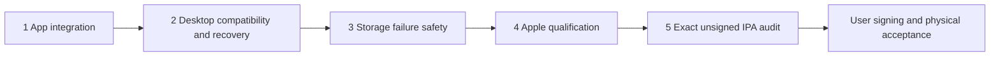

# iPhone completion milestones

Scope decision: 30 October 2026. The user restored the native background-transfer
work after temporarily trimming it. Complete the fixed milestones below; do not
keep expanding the feature list. Build120 is a foreground-copy engineering
checkpoint, separate from the finished native-engine target.

## Release-candidate qualification

The candidate enables the completed native import/upload adapter and foreground
Soulseek UI so acceptance tests exercise the production capability path. This
is an unpublished candidate, not a claim that its new installed probes passed.
The release-branch publisher refuses to publish unless the Apple build, both
installed simulator suites, mixed/background/process-recovery checks and exact
IPA/source audit succeed. Physical signing/device acceptance remains separate.
The earlier disabled-capability checkpoints below remain historical evidence.

## Fixed completion list

This is the complete pre-device list, fixed on 31 October 2026 (Europe/Paris).
Report these five items consistently; their implementation details do not become
additional milestones. Do not call the release nearly finished based on an
isolated foundation or quote a build count before the remaining source is frozen.

| Item | Definition of done and current evidence |
| --- | --- |
| 1. App integration | Copy-plan submission, the persistent native queue view, cancel/resume/preparation recovery, and verified import completion work together. Source now connects the existing approved desktop preview to a frozen native plan; admitted IDs survive lost replies and no post-submission foreground fallback occurs. The root-owned queue has bounded consistent pages and explicit uncertain-upload receipt checks. Real Isar, host FFprobe and portable native tests pass separately. The registered installed-app import probe exists; execution of the final connected source belongs to item 4. |
| 2. Desktop compatibility and upload recovery | Qualify the real desktop protocol, persist per-operation upload identity, safely handle uncertain/cancelled/requeued copies, and reconcile successful upload receipts with current local song identity. Desktop draft [PR728](https://github.com/lokal-music/desktop/pull/728) now provides scoped durable outcomes, generation fences and atomic track/content/receipt commits; actual receiver/process-crash and Swift interoperability tests pass. Native source admission persists its qualified protocol and can recover a lost reply by status without resending audio. Whole-plan older-peer selection now happens before any native admission and passes host tests. New upload intents now freeze the reviewed song/server binding; confirmed receipts associate only the currently reviewed song after fresh native source verification and an Isar writer recheck. Root mutation and durable song-ID protections cover completion and restart. The Nov6 source adds protocol-qualified same-key retry, durable remote cancellation/requeue decisions, late-commit handling, and reviewed replacement of a historical local association; host Swift/HTTP and Dart/Isar regressions pass. Native uncertain audio remains paused when no positive receipt exists. Cancelled/completed upload history must not be bypassed with new UUIDs. Installed Apple and daemon qualification of the enabled candidate remains a publication gate. |
| 3. Storage failure handling | Journal failure stops all native network/file admissions, revokes source/import authority, cancels and drains OS tasks and file work, preserves owned data, and permits only explicit recovery of durable truth. The centralized source path now has actual held-download/upload coverage, refused bad-storage recovery, eight coalesced recovery callers, no late callback writes, and no resend after restored recovery. Apple daemon behavior belongs to item 4. |
| 4. Apple qualification | Compile the final Swift/Flutter source with Apple SDKs; pass installed-app integration on iOS18.6/26, mixed-direction transfers, background interruption and relaunch, and storage/identity recovery. Host tests and a Dart debug kernel are not this qualification. The latest release instruction authorizes the necessary final Apple build and audit. Checkpoint 2cddb9bd passed Apple SDK/Flutter bridge checks, repeated native contracts and actual Isar/root recovery on the Apple runner. The connected 59e6d6b3 source also passed all 20 independent Apple native rounds and actual Isar/root recovery. The complete release Flutter selection now passes locally: 1,477 tests after updating ten stale fixture expectations; the focused fixture rerun passed all 34 tests. Build139 produced and inspected a real release/AOT device IPA, passed the simulator control app and actual cold launch, and saved the compiled integration app. Its runtime suite stopped at an outdated search-navigation fixture before the mixed-upload and daemon probes. That fixture is corrected for the enabled release candidate; those later probes remain publication gates. Those probes use isolated synthetic authorization/storage; no live P2P account or physical acceptance is inferred. |
| 5. Release artifact | Qualify the enabled candidate through items 1–4 and produce/audit its exact release/AOT unsigned IPA before publication with matching source, licenses, checksum, binary inventory and symbols. Physical signing, installation/upgrade and device acceptance remain the user's separate step. |

Existing isolated foundations—atomic CUE transitions, monotonic song IDs,
Clear/Forget custody reconciliation and completed-download history compaction—
remain part of item 1. They are not extra release items. The new app flow
shows preparation separately from queued/completed transfers and asks the user
to keep Lokal open until all selected files have been admitted. Native downloads
are submitted as one immutable batch; each source-authorized upload retains its
exact intent after an ambiguous reply. Existing private-copy recovery, external
sources and CUE segment export retain the complete foreground plan before native
admission; a partial native submission never switches to foreground copying.

Keep the implemented iOS16+ app and the relevant shared Android changes. The current continuation imports the final ordinary UI/service delta through PR503 (Android 7.4.7), while retaining the earlier PR368 and PR363 safeguards. The iPhone foreground Soulseek adapter now loads the bundled C ABI, receives synchronous UIKit cancellation and fences late login/status replies. Its pending imports join library drainage and are durably retired before deletion. Host cancellation/lifecycle regressions pass; installed FFI and peer qualification remain separate under items 1/4; see [the prior parity review](IOS_PARITY_20261105.md). The Nov6 delta includes signed HTTP add-ons, DASH/hybrid media, backing-vocal lyrics, FLAC lyric recovery, artwork recovery, player blur transitions, Home greeting and Online page preferences. Native Android transport changes remain Android-specific. The ordinary scope includes:
ordinary imports/CUE, library/playlists, lyrics/artwork, local/online playback,
add-ons/downloads, desktop link, network libraries, share/export and supported
casting/output adapters. PR361's live settings-search and bounded gapless queue
changes retain the iPhone retirement guards; PR362's SMB diagnostics, WebDAV
certificate approval and failed-sync preservation are included. Android's LAN
permission prompt remains Android-only; iOS uses its existing local-network
permission declaration. PR363 adds new-install promotion and drag-and-drop
source priority, with preference rejection treated as a save failure. PR365 adds native libsmb2 and NAS WebDAV href compatibility, with iPhone
scan-retirement guards and pinned-framework preparation/package checks. PR367
bounds NAS artwork/resource use and recovers embedded art; PR368 makes full
desktop sync manual while automatic listening-stat pages remain bounded. See
[the NAS verification scope](IOS_NAS.md). Host tests do not establish iPhone NAS interoperability or
measured gapless latency on an iPhone. Background audio remains required. Home Screen widgets
and impractical Android-specific direct audio remain excluded.

Keep PR356–357 data-safety and historical-ID fixes. The release candidate enables native `libraryImport` and `upload`; publication remains blocked until the replacement engine is accepted by all automated gates. Foreground
copying remains usable: keep Lokal open with the iPhone unlocked and the desktop
awake on Wi-Fi, and check again after interruptions to retry unfinished files.
The iPhone copy UI remains accurate while native transfers are disabled.

## Candidate qualification and handoff

Preserve each frozen candidate's source and qualification evidence. Build120
may qualify the foreground-copy checkpoint; it does not contain later engine
changes. Use the existing app/simulator acceptance and independent IPA audit,
and rebuild only for actual implementation changes or concrete failures.

The user handles physical iPhone signing, installation/upgrade and device
playback/route acceptance using the Windows instructions. Provide the matching
unsigned IPA, build/commit, checksum, source/notices and symbols. Never infer
physical acceptance from host tests or report an unexecuted native probe as passed.

