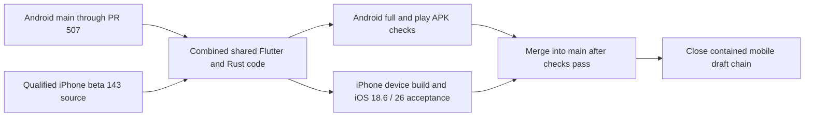

# Integrating the iPhone beta with Android main

The published unsigned beta remains `ios-sideload-beta-143-attempt1`, built from
`1200c910558652f65cb5211c69a8968af984d46c`. Its qualification evidence applies
to those exact bytes. Signing and real-iPhone acceptance remain outstanding.

This integration combines that source history with Android main through PR #507
(`878204c52ec56a8c6f825276818609520f545841`), including offline motion-cover
caching, cellular Eco behavior, playlist hero precaching and Morneye 5.3.
It preserves the current Android native tree, USB/mixer implementation and both
Android flavors. Shared Rust/Dart bindings are regenerated from the combined API.

A merge commit retains both histories. All 58 audited mobile draft heads are
ancestors of the published beta source; they need not be merged individually.
Any draft whose head changes must be rechecked before closure. Desktop PR #728
is independent and is outside this mobile cleanup.

Integration regression checks cover native request retirement, background
transfers, Android USB/mixer APIs, codec identity across library rescans, original
spatial-file saves without a playback decoder, and localized source settings.
The legacy ARB allowlist records 431 keys already unreferenced on Android main;
it does not exempt new unused keys. Scanner placeholder recognition now handles
all shipped locales so a language change cannot block later tag enrichment.

Android CI is manually disabled in repository settings. A separate Android
compatibility workflow runs only on this consolidation branch, without changing
that setting. The consolidation must pass its Android and iPhone workflows
before merge.
It does not inherit a passing status from beta 143 and does not publish or replace
that release. The resulting engineering IPA still needs physical-device checks.
iOS widgets remain excluded.
