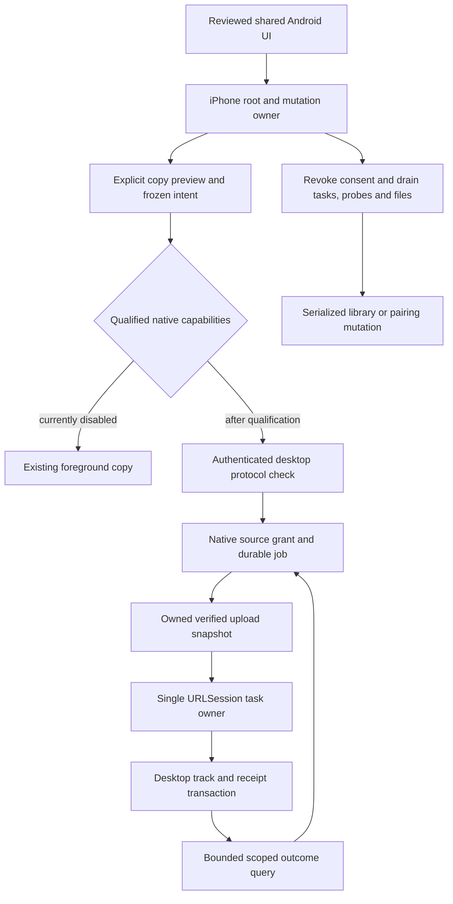

# iPhone continuation against Android 7.2.5

Reviewed on 5 November 2026 (Europe/Paris). The repositories are now
[lokal-music/mobile](https://github.com/lokal-music/mobile) and
[lokal-music/desktop](https://github.com/lokal-music/desktop). The reviewed mobile
snapshot is `a720d66705d3498b6980fbdeaf8ffc1315300a9a`, through merged PR472;
the latest published Android release is 7.2.5. The iPhone PR stack has not been
merged or requalified as a new IPA during the interruption.

This continuation carries the final shared changes since the already-ported
PR368 snapshot, rather than reproducing intermediate broken playlist parsers,
reverted motion designs or Android-only platform code. Preserve the fixed five
completion items in [IOS_FIRST_RELEASE.md](IOS_FIRST_RELEASE.md).

| Area | iPhone continuation |
| --- | --- |
| Spotify and YouTube Music | Library playlists, account-separated caches, visibility, sorting and track/download controls, including the subsequent parser/build fixes. |
| Stations | Radio Browser, quality and country/genre filters, persistent browsing choices, current metadata/artwork and shared full-player presentation. Existing iPhone local-audio retirement remains authoritative. |
| Desktop link | Shared-song playback, remote full player/queue/lyrics, bounded listening sync, artwork retention and explicit full-library sync. Copy and Forget continue through the iPhone mutation owner. |
| Library, search and artwork | Local search scope, linked-song identity, artist credits/logos, durable NAS covers, embedded artwork recovery, manual repair and lyrics metadata corrections. Batched NAS writes retain the iPhone scan epoch. |
| UI and motion | Final navigation, progressive detail artwork, Space cover reveal, J-shaped artwork return, compact glass footer and performance changes through PR472. Retain reduced-motion and accessibility behavior. |
| Soulseek | Shared interface/source and the pinned protocol C ABI are carried over; the new product client currently targets Android. iPhone sign-in and its search scope remain unavailable until the native client, file access and foreground lifecycle are integrated and qualified. This work belongs to the existing app/parity item; source reuse alone is not a port. |
| Android USB mixer/direct audio | Platform-specific code is excluded from iPhone capability claims. Widgets remain excluded by the user's scope decision. |

## Upload protocol and authority

[Desktop draft PR728](https://github.com/lokal-music/desktop/pull/728) records
account/device-scoped upload outcomes atomically with playable originals. It
preserves the current desktop's chosen phone folder and volume checks, fences
older receiving workers, and excludes private receiving files from library scans.
A historical operation never recreates an original the user deleted.

Native source admission now checks the bounded authenticated peer capability
before creating a job or sending audio. Its protocol version is native-owned,
persisted with the job and immutable across updates; Flutter cannot supply it in
a copy intent. URLSession task reconciliation verifies the operation headers.
A qualified lost reply can recover its exact original through read-only status;
legacy history retains its conservative content query and no blind resend.
Control probes join Clear/Forget, storage-failure and source-retirement drainage.

Before admitting any native job, upload-containing plans now perform a bounded
read-only capability query and retain the whole foreground path on older peers.
Download-only plans do not require the upload extension. A library mutation during
that query retires the preview; native admission still independently validates
current authority. Durable safe retry/cancel/requeue semantics and successful receipt binding to the current local song remain part
of completion item 2. Do not weaken the original-key guard or infer retry
permission from an absent operation. Native import/upload flags stay false.

## Evidence and limits

The desktop source has 58 passing local receiver/storage/network tests, including
actual HTTP, authentication, SQLite/WAL, filesystem changes and seven process-exit
boundaries. A separate production Swift-to-desktop test passes for Unicode
fingerprints, stable replay, outcome recovery and cancellation fencing. These
checks use Node's SQLite test adapter, not installed Electron qualification.

Portable native tests also cover unsupported/future/redirected capabilities,
durable negotiation proof, lost-response status recovery without another POST,
and cancellation/drainage while a capability response is held. The actual Isar
root-coordinator harness passes with host FFprobe; native RPC/file-custody ports
in that harness remain fixtures. Three host contracts for the actual Soulseek C
ABI module pass with the application's exact locked dependencies (path traversal,
share-root symlinks and session-loss reporting). Reproduce them with
`python3 tool/soulseek_host_contracts.py --work-dir /path/to/generated/workspace`.
This does not establish iPhone network/lifecycle qualification.

The complete selected regression run passes **635 tests across 90 files**,
including the changed/shared Android tests and iPhone copy/queue/retirement
regressions. A separate earlier safety selection passed 117 cases (overlapping;
these counts are not additive). Library and test analysis report no errors;
legacy lint findings remain (31 library warnings/737 infos, 8 test warnings/59
infos), so analysis is not described as lint-clean.
The continuation corrects genuine navigation state/reversal faults, a zero-width
remote full-cover swipe surface, large-text header overflow, and marquee pause
cleanup. Updated fixtures retain their behavioral assertions while following the
new UI and current Flutter lifecycle.

The final integration-test debug kernel compiles and the generated bundle includes
the exact pinned Soulseek MIT notice exposed in About → Licences. This is a Dart
bundle build, not an Apple build or installed-app run.

No new Apple SDK, installed iOS 18.6/26, background-daemon or release/AOT IPA
qualification is claimed. CI has not been polled or awaited. Existing qualified
engineering artifacts refer to their older frozen source. Signing and physical
installation/upgrade/playback acceptance remain the user's separate step.
